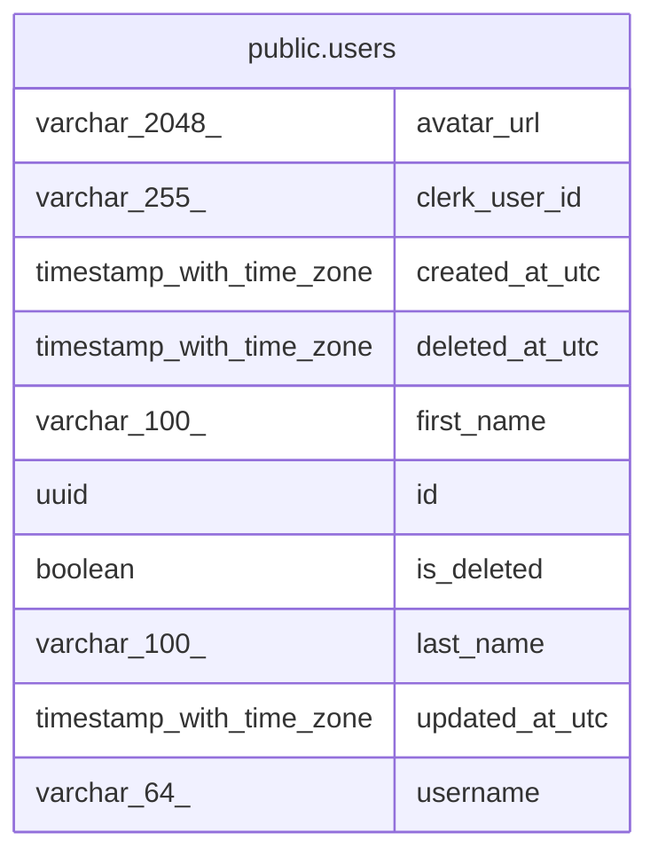

# Social Media

## Tables

| Name                            | Columns | Comment                                                                                            | Type       |
| ------------------------------- | ------- | -------------------------------------------------------------------------------------------------- | ---------- |
| [public.users](public.users.md) | 10      | People who use the app. Sign-in is handled by Clerk; each row is the local copy of one Clerk user. | BASE TABLE |

## Relations

---

> Generated by [tbls](https://github.com/k1LoW/tbls)
