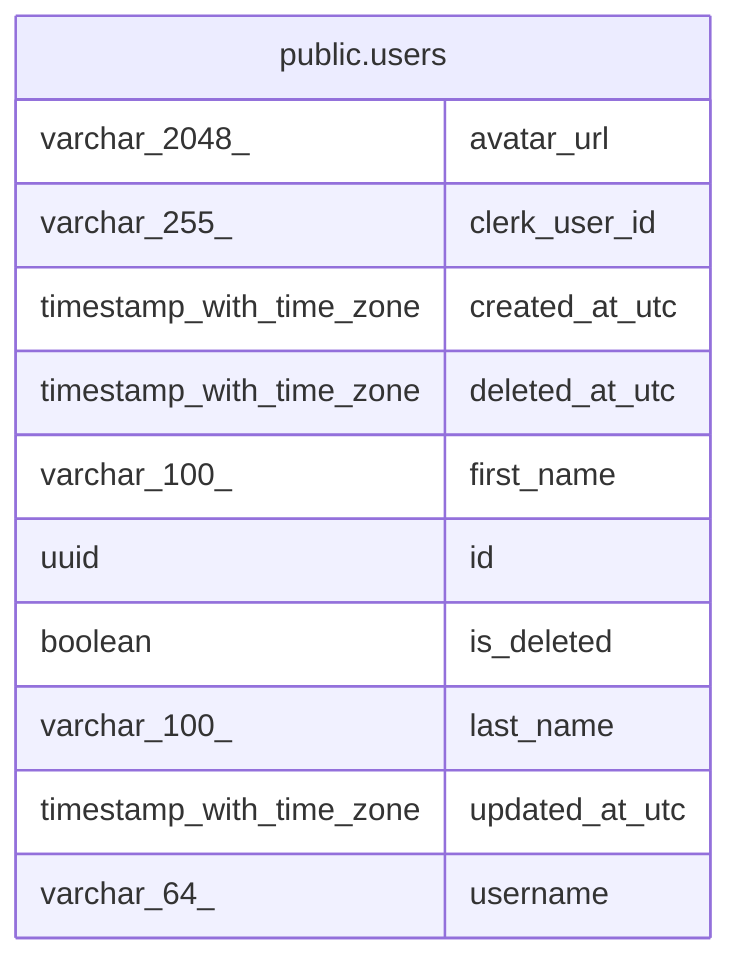

# public.users

## Description

People who use the app. Sign-in is handled by Clerk; each row is the local copy of one Clerk user.

## Columns

| Name           | Type                     | Default | Nullable | Children | Parents | Comment                                                                          |
| -------------- | ------------------------ | ------- | -------- | -------- | ------- | -------------------------------------------------------------------------------- |
| avatar_url     | varchar(2048)            |         | true     |          |         | URL of the profile image copied from Clerk. Null when the user has none.         |
| clerk_user_id  | varchar(255)             |         | false    |          |         | Identifier of the user in Clerk, taken from the sub claim of the session token.  |
| created_at_utc | timestamp with time zone |         | false    |          |         | When the row was created, in UTC.                                                |
| deleted_at_utc | timestamp with time zone |         | true     |          |         | When the user was soft-deleted, in UTC. Null while the user is not deleted.      |
| first_name     | varchar(100)             |         | true     |          |         | First name copied from Clerk. Null when the user has none.                       |
| id             | uuid                     |         | false    |          |         | Identifier of the user in this system (UUID v4).                                 |
| is_deleted     | boolean                  |         | false    |          |         | True when the user has been soft-deleted. Deleted users are hidden from queries. |
| last_name      | varchar(100)             |         | true     |          |         | Last name copied from Clerk. Null when the user has none.                        |
| updated_at_utc | timestamp with time zone |         | true     |          |         | When the row was last changed, in UTC. Null when it has never been changed.      |
| username       | varchar(64)              |         | true     |          |         | Username copied from Clerk. Null when the user has none.                         |

## Constraints

| Name                          | Type        | Definition              |
| ----------------------------- | ----------- | ----------------------- |
| PK_users                      | PRIMARY KEY | PRIMARY KEY (id)        |
| users_clerk_user_id_not_null  | n           | NOT NULL clerk_user_id  |
| users_created_at_utc_not_null | n           | NOT NULL created_at_utc |
| users_id_not_null             | n           | NOT NULL id             |
| users_is_deleted_not_null     | n           | NOT NULL is_deleted     |

## Indexes

| Name                   | Definition                                                                               |
| ---------------------- | ---------------------------------------------------------------------------------------- |
| IX_users_clerk_user_id | CREATE UNIQUE INDEX "IX_users_clerk_user_id" ON public.users USING btree (clerk_user_id) |
| PK_users               | CREATE UNIQUE INDEX "PK_users" ON public.users USING btree (id)                          |

## Relations

---

> Generated by [tbls](https://github.com/k1LoW/tbls)
